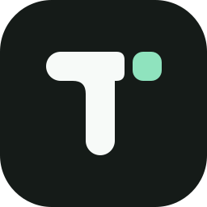
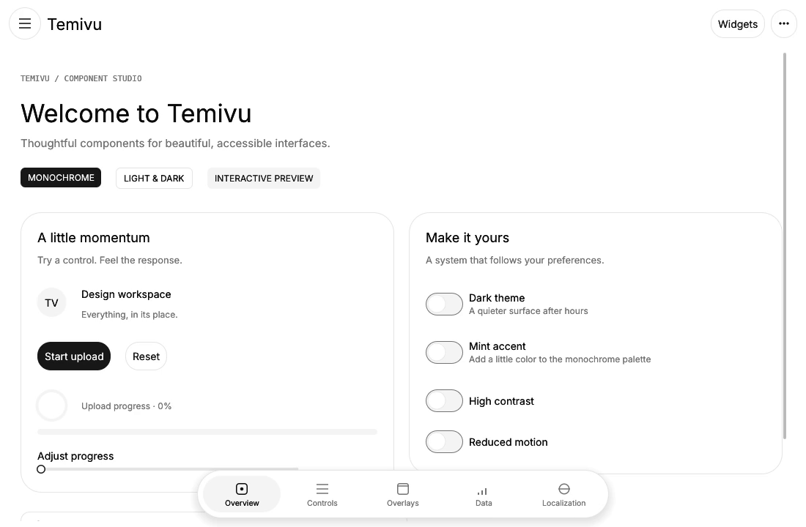

**[Overview](#overview) · [Demo](#demo) · [Quick start](#quick-start) · [Documentation](#documentation) · [Changelog](CHANGELOG.md) · [Contributing](CONTRIBUTING.md)**



# Temivu

**UI components with responsive layouts and spring-based motion for Rust and egui.**

## Overview

Temivu helps developers build interfaces for egui applications with a consistent visual language and caller-owned state. Controls, navigation, overlays and data views share theme tokens and motion settings. The library can be integrated into existing egui layouts one widget at a time.

| Area | What the library provides |
| --- | --- |
| Controls | Buttons, switches, form inputs, selects, sliders, segments and progress indicators |
| Navigation | Floating bottom navigation, drawers, menus, tabs and shared-source page transitions |
| Overlays | Dialogs, sheets, popovers, tooltips and queued notifications |
| Data and media | Calendar and time controls, pagination, resizable panels and video player controls |
| Foundation | Monochrome and mint themes, touch sizing, localization and reduced-motion settings |

Temivu builds on its [Forui port](docs/MIGRATION.md). Its visual and motion design also draws on [shadcn/ui](https://ui.shadcn.com/), [SwiftUI and Apple’s iOS 26 Liquid Glass sessions](https://developer.apple.com/videos/play/wwdc2025/219/), [iOS 27 navigation design](https://developer.apple.com/videos/play/wwdc2026/269/) and [Material 3 Expressive](https://design.google/library/expressive-material-design-google-research).

## Demo

[](docs/demo/temivu-showcase.mp4)

[Watch or download the showcase recording (MP4)](docs/demo/temivu-showcase.mp4) · [Widget catalog screenshot](docs/demo/catalog.png) · [Dialog screenshot](docs/demo/dialog.png)

The native showcase includes an interactive widget catalog and dedicated pages for controls, overlays, data and localization. The recording shows the catalog transition and a dialog entering before the Data page opens.

## Quick start

Rust 1.95 or later is required. The library is distributed as source through this repository.

```bash
git clone https://github.com/kappyra/temivu.git
cd temivu
cargo run --locked --features demo --example showcase
```

The showcase needs a desktop graphics session. Local video playback in the Linux showcase also needs system Python with PyGObject, GStreamer 1.0 and plugins for the chosen media format. The library’s `VideoPlayer` is a UI component that accepts a texture and emits playback actions for the host’s media backend.

Use a Temivu component in any egui view:

```rust
use temivu::{Button, Switch, Theme};

fn settings(ui: &mut egui::Ui, theme: &Theme, notifications: &mut bool) -> bool {
    Switch::new(notifications, theme)
        .label("Notifications")
        .show(ui);
    Button::new("Save changes", theme).show(ui).clicked()
}
```

Create a theme such as `Theme::light()` in the host, apply it to the egui context when the preference changes and keep application state between frames. Use stable widget IDs for stateful controls and transitions.

## Documentation

- [Component inventory and coverage](docs/COVERAGE.md)
- [Navigation menus and responsive presentation](docs/NAVIGATION_MENU.md)
- [Bloom and Droplet motion presets](docs/LIQUID_MOTION.md)
- [Calendar API and keyboard behavior](docs/CALENDAR.md)
- [Accessibility and verification scope](docs/ACCESSIBILITY.md)
- [Changes since the first public version](CHANGELOG.md)

The native showcase was captured on Linux. The widgets are designed for reuse across egui hosts, with web and mobile validation still pending. The API is pre-1.0. The [dependency advisory record](docs/DEPENDENCY_ADVISORIES.md) tracks three open informational advisories in the optional Linux accessibility stack.

## License

Temivu is distributed under the [MIT License](LICENSE). The [third-party notices](THIRD_PARTY_NOTICES.md) preserve Forui attribution and the terms for bundled fonts and other assets. The [first public release](https://github.com/kappyra/temivu/releases/tag/v0.0.0) remains available as a [source ZIP](https://github.com/kappyra/temivu/releases/download/v0.0.0/temivu-v0.0.0-source.zip).
