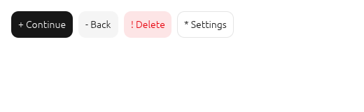
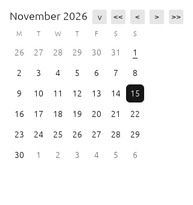
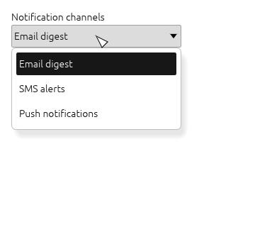

# Temivu

**Экспериментальный нативный порт компонентов Forui на Rust/egui.**

[English](README.md) · [Tiếng Việt](README.vi.md) · [Русский](README.ru.md) · [中文](README.zh.md)

> **Статус: ранний эксперимент, не готов к использованию в продакшене.** Temivu — это
> независимое исследование того, как язык дизайна Forui переносится в immediate-mode
> Rust и egui. Все 44 модуля компонентов Forui имеют предварительный порт, и демо
> показывает каждый из них, но ни один компонент не проверен на полное соответствие
> upstream, а стабильного релиза пока нет. Перед использованием прочитайте
> [Известные ограничения](#известные-ограничения).



## Зачем я это сделал

Мне нравится визуальный язык Forui, но я пишу нативные десктопные приложения на Rust.
Я начал Temivu, чтобы проверить, можно ли получить такие же элементы управления —
кнопки, формы, выпадающие списки, календари, оверлеи, навигацию — с такими же
отступами, цветовыми токенами, типографикой, поведением клавиатуры и доступностью, не
встраивая Flutter. Это честное *исследование*, а не копия движка Forui: проект
адаптирует публичные токены и поведение Forui к immediate-mode модели egui, а всё
долговременное состояние принадлежит вызывающему коду.

Я разрабатывал порт с помощью ИИ-ассистента по программированию (DeepSeek Harness):
он выполнял большую часть механической черновой работы и проверок. Область работ,
решения и планку качества задавал я, и я отвечаю за то, что здесь опубликовано.

## Что внутри

- **44 предварительных модуля компонентов** — accordion, alert, autocomplete, avatar,
  badge, bottom navigation, breadcrumb, button, calendar, card, checkbox, context menu,
  date field, date-time picker, dialog, divider, header, item, field label, line
  calendar, OTP field, pagination, picker, popover, popover menu, progress, radio,
  resizable, scaffold, select, select group, select menu tile, select tile group,
  sheet, sidebar, slider, switch, tabs, text field, tile, time field, time picker,
  toast, toaster и tooltip.
- **Нейтральная тема на токенах** (светлая, тёмная, touch-масштаб, уменьшенная
  анимация и опциональный пресет высокой контрастности) с токенами типографики и размеров.
- **Инфраструктура локализации** — 37 смысловых сообщений, сгенерированных из 113
  upstream ARB-файлов, с англоязычным запасным вариантом и сопоставлением подтегов локали.
- **Нативное демо из пяти страниц** — `cargo run --features demo --example showcase` —
  со всеми семействами компонентов, темами, уменьшенной анимацией и локализацией.
- **Тесты** — 402 теста на Rust, включая настоящие интерактивные тесты `egui_kittest`
  для каждого семейства компонентов, проверки доступности, детерминированную логику
  даты/времени и проверки контраста темы.



| Область | Что ожидать сегодня |
| --- | --- |
| Тема и токены | Достаточно стабильна для экспериментов; цвета и размеры адаптированы из Forui, есть пресет высокой контрастности |
| Поля ввода и кнопки | Проверены клавиатурой и экранным диктором через kittest; иконки — приближение текстовыми глифами |
| Списки, пикеры, автодополнение | Предварительный поиск, мультивыбор, выбор месяца/года в календаре, колесо выбора, выбор времени/даты |
| Оверлеи | Dialog, sheet, popover, popover menu и toast/toaster работают, но анимации и жесты не завершены |
| Визуальное соответствие | Заметно ближе к upstream, но не доказано; шрифты, иконки, blur и метрики текста Flutter остаются пробелами |
| Доступность | Роли/метки/значения AccessKit и клавиатурные сценарии покрыты тестами; ручного аудита с экранным диктором ещё нет |

## Быстрый старт

Нужен Rust 1.95 или новее (edition 2024). Библиотеки пока нет на crates.io;
подключайте через путь или git.

```toml
[dependencies]
# from git:
temivu = { git = "https://github.com/vutienthan/temivu" }
# from a local clone instead:
# temivu = { path = "../temivu" }
egui = "=0.36.2"
```

> Если вы клонировали репозиторий, используйте вариант с `path`, как показано выше.

```rust
use temivu::{Button, Dialog, Header, Theme};

fn page(ui: &mut egui::Ui, dialog_open: &mut bool) {
    let theme = Theme::light();
    Header::new("Пример", &theme).show(ui, |_| {});
    if Button::new("Показать детали", &theme).show(ui).clicked() {
        *dialog_open = true;
    }
    Dialog::new(egui::Id::new("details-dialog"), "Детали")
        .show(ui.ctx(), dialog_open, |ui| {
            ui.label("Здесь содержимое.");
        });
}
```

Вызывайте `Theme::apply` при смене темы. Долговременное состояние принадлежит
вызывающему коду: храните его между кадрами и вызывайте каждый виджет каждый кадр,
включая закрытые оверлеи, чтобы dialog и sheet могли восстановить фокус. ID должны
быть стабильными и уникальными.

Запуск демо на поддерживаемом графическом десктопе:

```bash
cargo run --features demo --example showcase
```

Запуск тестов (дисплей не нужен):

```bash
cargo test --all-features
```

## Структура проекта

```
src/               библиотека (44 модуля компонентов/основы)
tests/             модульные и интерактивные тесты egui_kittest
examples/          нативное демо из пяти страниц
docs/              заметки о компонентах, матрица покрытия, план миграции
harness/port/      извлечение и проверка сгенерированных токенов и локализаций
harness/visual-review/  внеэкранный рендер, эталоны и сравнение
branding/          временная айдентика проекта
third_party/       тексты лицензий upstream
```

Полный внутренний QA-harness, который я использовал при разработке (снимки CodeQL,
учёт независимых ревью, инвентаризация лицензий и зависимостей), намеренно не входит
в публичный репозиторий; генераторы и инструмент визуального сравнения включены.

## Проверка

Я проверяю изменения послойно: форматирование, Clippy с запретом предупреждений,
полный набор тестов и тесты документации при каждом изменении; CodeQL, независимое
ревью и аудит зависимостей на вехах интеграции; рендер скриншотов для компонентов, у
которых меняется внешний вид. Сейчас:

- 402 проходящих теста Rust и проходящие тесты документации;
- сканирование CodeQL с чистым извлечением и только двумя проверенными
  ложноположительными срабатываниями (boolean-флаги маскировки пароля);
- сканирование истории Gitleaks без утечек учётных данных;
- проверенные эталоны светлых/тёмных листов в `harness/visual-review/baselines/`;
- задокументированные предупреждения зависимостей в
  [docs/DEPENDENCY_ADVISORIES.md](docs/DEPENDENCY_ADVISORIES.md).

`cargo-deny` сейчас сообщает о трёх *информационных* предупреждениях о
неподдерживаемых пакетах (`zvariant`, `zbus_names`, `zvariant_derive`) в
опциональной цепочке доступности Linux. Они не подавлены: совместимого обновления
или поддерживаемой замены по состоянию на ноябрь 2026 года нет, доступность
остаётся включённой, а проблема отслеживается открыто. Workflow GitHub в
`.github/workflows/` запускают те же проверки качества, зависимостей и CodeQL;
задание зависимостей может завершаться ошибкой, чтобы сообщать, а не скрывать проблему.

## Известные ограничения

- **Не для продакшена.** API, внешний вид и поведение будут меняться; релиза пока нет.
- **Соответствие upstream не доказано.** Шрифты, векторные иконки, backdrop blur,
  суперэллиптические углы, метрики текста Flutter и кривые анимации отличаются от Forui.
  Скриншоты в репозитории сравниваются с предыдущими версиями проекта, а не с
  эталонными изображениями upstream.
- **Доступность покрыта только автотестами.** Роли, метки, значения AccessKit,
  клавиатура и контраст проверены; ручного аудита с экранным диктором и режимом
  принудительных цветов не было.
- **Оверлеи неполны:** анимация появления/исчезновения, свайп-жесты и отдельные
  случаи фокуса пока не реализованы.
- **Локализация частичная:** 37 сообщений; даты, время, числа, множественные формы
  и RTL не реализованы.
- **Проверки в desktop-сессии и CI пока не зафиксированы**; приложенные workflow
  предназначены для участников и сопровождающих.

## Участие в проекте

Я очень хочу, чтобы Temivu стало сообществом, и буду рад любой помощи. Вам не нужно
быть экспертом по Rust или знать Forui в деталях — достаточно любопытства. Чем можно помочь:

- **Визуальное соответствие:** сравните компонент с закреплённой ревизией Forui
  (`eea1e8e651d263f14ef43897ccbb7a2576549da5`) и опишите различия.
- **Доступность:** обзоры клавиатуры, экранных дикторов, принудительных цветов и контраста.
- **Локализация:** форматы дат/времени, множественные формы, RTL и новые языки.
- **Производительность:** профилирование, измерение frame time и поиск горячих точек аллокаций.
- **Зависимости:** поиск поддерживаемой замены для цепочки предупреждений доступности —
  с тестами и проверкой лицензий, а не только ради отключения предупреждения.

Начните с [CONTRIBUTING.md](CONTRIBUTING.md) и трекера задач. Если не знаете, с чего
начать, откройте обсуждение или попросите метку «good first issue» — я вежливо помогу
найти задачу по интересам. Пожалуйста, прочитайте [Кодекс поведения](CODE_OF_CONDUCT.md).
Будьте добры; это учебный проект.



## План до 1.0

1. **Alpha** — все модули в области охвата имеют протестированные API, демо
   собирается и запускается, пробелы поведения задокументированы в
   [docs/COVERAGE.md](docs/COVERAGE.md).
2. **Beta** — достигнут базовый уровень доступности, визуальная матрица сравнена с
   измеримыми порогами, бюджеты производительности определены на документированной
   эталонной машине, документация переписана для пользователей.
3. **1.0** — релизные проверки проходят с задокументированными принятыми ограничениями:
   нет открытых серьёзных предупреждений, полные уведомления, воспроизводимые сборки,
   стабильный публичный API. Подробная область будет опубликована в `docs/ROADMAP.md`;
   буду рад отзывам.

## Лицензия и атрибуция

Temivu распространяется по лицензии MIT — см. [LICENSE](LICENSE). Это независимый
проект, **не связанный с Forui или Duobase IO и не одобренный ими**. Forui
распространяется по MIT; его текст лицензии и лицензии других упомянутых пакетов и
шрифтов воспроизведены в [THIRD_PARTY_NOTICES.md](THIRD_PARTY_NOTICES.md) и
`third_party/`. Название, логотип и знак временные и не прошли проверку товарных
знаков; см. [BRANDING.md](BRANDING.md).
