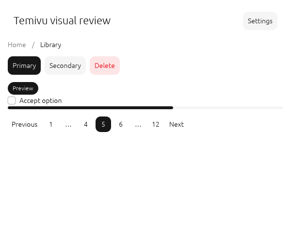
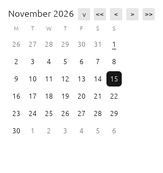
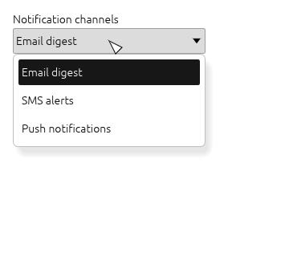

# Temivu

**Một bản chuyển thử nghiệm thư viện thành phần Forui sang Rust/egui thuần.**

[English](README.md) · [Tiếng Việt](README.vi.md) · [Русский](README.ru.md) · [中文](README.zh.md)

> **Trạng thái: thử nghiệm sớm, chưa sẵn sàng cho sản phẩm.** Temivu là một nghiên cứu
> độc lập về cách chuyển ngôn ngữ thiết kế của Forui sang Rust và egui. Cả 44 mô-đun
> thành phần của Forui đều đã có bản chuyển sơ bộ và bản demo có đủ các thành phần đó,
> nhưng chưa có thành phần nào được xác minh tương đương hoàn toàn với upstream và chưa
> có bản phát hành ổn định. Vui lòng đọc [Hạn chế đã biết](#hạn-chế-đã-biết) trước khi dùng.



## Vì sao tôi làm dự án này

Tôi thích ngôn ngữ hình ảnh của Forui nhưng lại viết ứng dụng desktop gốc bằng Rust.
Tôi bắt đầu Temivu để xem liệu có thể có được những điều khiển tương tự — nút, biểu
mẫu, select, lịch, lớp phủ, điều hướng — với cùng khoảng cách, bảng màu, kiểu chữ, hành
vi bàn phím và khả năng tiếp cận, mà không phải nhúng Flutter. Đây là một *nghiên cứu*
trung thực chứ không phải bản sao động cơ của Forui: dự án chuyển các token và hành vi
công khai của Forui sang mô hình immediate-mode của egui, và người gọi sở hữu toàn bộ
trạng thái lâu dài.

Tôi phát triển bản chuyển này với sự hỗ trợ của một trợ lý lập trình AI (DeepSeek
Harness) trong phần lớn công việc soạn thảo và kiểm chứng máy móc. Tôi đặt phạm vi,
quyết định và tiêu chuẩn đánh giá, và tôi chịu trách nhiệm về những gì được công bố ở đây.

## Những gì có trong dự án

- **Toàn bộ 44 mô-đun thành phần của Forui** (sơ bộ), cùng ba mở rộng riêng của dự án — accordion, alert, autocomplete, avatar, badge,
  bottom navigation, breadcrumb, button, calendar, card, checkbox, context menu,
  date field, date-time picker, dialog, divider, header, item, field label, line
  calendar, OTP field, pagination, picker, popover, popover menu, progress, radio,
  resizable, scaffold, select, select group, select menu tile, select tile group,
  sheet, sidebar, slider, range slider, switch, tabs, text field, tile, time field,
  time picker, toast, toaster và tooltip, cùng multi-select.
- **Bộ token giao diện trung tính** (sáng, tối, tỉ lệ cảm ứng, giảm chuyển động và
  preset tương phản cao tùy chọn) cùng token kiểu chữ và kích thước.
- **Hạ tầng bản địa hóa** — 37 thông điệp ngữ nghĩa sinh từ 113 tệp ARB upstream, có
  dự phòng tiếng Anh và khớp thẻ ngôn ngữ.
- **Bản demo native năm trang** — `cargo run --features demo --example showcase` —
  minh họa mọi nhóm thành phần, giao diện, giảm chuyển động và bản địa hóa.
- **Kiểm thử** — 402 bài kiểm thử Rust, gồm kiểm thử tương tác `egui_kittest` với
  sự kiện thật cho từng nhóm thành phần, kiểm tra khả năng tiếp cận, logic ngày giờ
  tất định và độ tương phản của theme.



| Lĩnh vực | Hiện trạng |
| --- | --- |
| Theme & token | Đủ để thử nghiệm; màu sắc và kích thước phỏng theo Forui, có preset tương phản cao |
| Nhập liệu & nút | Ngữ nghĩa AccessKit và bàn phím đã có kittest; chưa kiểm thử với trình đọc màn hình; biểu tượng là ký tự gần đúng |
| Select, picker, autocomplete | Tìm kiếm sơ bộ, multi-select, lịch chọn tháng/năm, picker bánh xe, chọn ngày/giờ |
| Lớp phủ | Dialog, sheet, popover, popover menu, toast/toaster hoạt động nhưng còn thiếu animation và gesture |
| Tương đương hình ảnh | Một số điểm được chủ động đưa gần upstream hơn, nhưng chưa đo lường hay chứng minh; font, icon, blur và số đo chữ Flutter vẫn là khoảng trống |
| Khả năng tiếp cận | Vai trò/nhãn/giá trị AccessKit và bàn phím có kiểm thử; chưa có đánh giá thủ công với trình đọc màn hình |

## Bắt đầu nhanh

Cần Rust 1.95 trở lên (edition 2024). Thư viện chưa có trên crates.io; hãy dùng
đường dẫn hoặc git.

```toml
[dependencies]
# from git:
temivu = { git = "https://github.com/vutienthan/temivu" }
# from a local clone instead:
# temivu = { path = "../temivu" }
egui = "=0.36.2"
```

> Nếu bạn clone kho lưu trữ, dùng biến thể `path` như ghi chú ở trên.

```rust
use temivu::{Button, Dialog, Header, Theme};

fn page(ui: &mut egui::Ui, dialog_open: &mut bool) {
    let theme = Theme::light();
    Header::new("Ví dụ", &theme).show(ui, |_| {});
    if Button::new("Xem chi tiết", &theme).show(ui).clicked() {
        *dialog_open = true;
    }
    Dialog::new(egui::Id::new("details-dialog"), "Chi tiết")
        .show(ui.ctx(), dialog_open, |ui| {
            ui.label("Nội dung chi tiết ở đây.");
        });
}
```

Gọi `Theme::apply` khi giao diện thay đổi. Trạng thái lâu dài do người gọi sở hữu:
giữ nó qua các frame và gọi mỗi widget mỗi frame, kể cả lớp phủ đang đóng, để dialog và
sheet khôi phục tiêu điểm. ID phải ổn định và duy nhất.

Chạy demo trên desktop đồ họa được hỗ trợ:

```bash
cargo run --features demo --example showcase
```

Chạy kiểm thử (không cần màn hình):

```bash
cargo test --all-features
```

## Cấu trúc dự án

```
src/               thư viện (47 mô-đun thành phần cùng phần nền tảng)
tests/             kiểm thử đơn vị và egui_kittest
examples/          bản demo native năm trang
docs/              ghi chú thành phần, ma trận bao phủ, kế hoạch chuyển đổi
harness/port/      trình trích xuất/kiểm tra token và bản địa hóa sinh tự động
harness/visual-review/  công cụ chụp ảnh ngoài màn hình, baseline và so sánh
branding/          nhận diện tạm thời của dự án
third_party/       văn bản giấy phép upstream
```

Toàn bộ harness QA nội bộ tôi dùng khi phát triển (chụp snapshot CodeQL, theo dõi
đánh giá độc lập, kiểm kê giấy phép/phụ thuộc) cố ý không nằm trong kho công khai;
các trình sinh mã và công cụ so sánh hình ảnh dùng lại được thì có.

## Kiểm chứng

Tôi kiểm chứng theo từng lớp: định dạng, Clippy coi cảnh báo là lỗi, toàn bộ kiểm thử và
kiểm thử tài liệu ở mỗi thay đổi; CodeQL, đánh giá độc lập và kiểm toán phụ thuộc ở mốc
tích hợp; và ảnh chụp cho thành phần có thay đổi hình ảnh. Hiện tại:

- 402 bài kiểm thử Rust và kiểm thử tài liệu đạt;
- quét CodeQL trích xuất sạch, chỉ có hai cảnh báo đã được đánh giá là dương tính giả
  (cờ boolean che mật khẩu);
- quét lịch sử bằng Gitleaks, không phát hiện thông tin xác thực bị lộ;
- bộ ảnh thành phần sáng/tối đã được đánh giá trong `harness/visual-review/baselines/`;
- các cảnh báo phụ thuộc được ghi tại [docs/DEPENDENCY_ADVISORIES.md](docs/DEPENDENCY_ADVISORIES.md).

`cargo-deny` hiện báo ba cảnh báo *thông tin, không còn được bảo trì* (`zvariant`,
`zbus_names`, `zvariant_derive`) trong chuỗi khả năng tiếp cận Linux tùy chọn. Chúng
không bị che giấu: chưa có bản nâng cấp tương thích hay thay thế được bảo trì tính đến
tháng 11 năm 2026, khả năng tiếp cận vẫn bật và vấn đề được theo dõi công khai. Các
workflow GitHub trong `.github/workflows/` chạy cùng các kiểm tra chất lượng, phụ thuộc
và CodeQL; job phụ thuộc được phép lỗi để báo cáo thay vì che giấu vấn đề.

## Hạn chế đã biết

- **Chưa sẵn sàng cho sản phẩm.** API, hình ảnh và hành vi sẽ thay đổi; chưa có bản phát hành.
- **Chưa chứng minh tương đương upstream.** Font, icon vector, blur nền, góc
  superellipse, số đo chữ Flutter và đường cong animation khác Forui. Ảnh trong kho
  được đánh giá so với phiên bản trước của dự án, không phải ảnh vàng upstream.
- **Khả năng tiếp cận mới chỉ có kiểm thử tự động.** Vai trò, nhãn, giá trị AccessKit,
  bàn phím và độ tương phản đã được kiểm; chưa có đánh giá thủ công với trình đọc màn
  hình hay chế độ màu cưỡng bức.
- **Lớp phủ chưa hoàn chỉnh:** animation vào/ra, gesture vuốt và một số trường hợp
  tiêu điểm còn thiếu.
- **Bản địa hóa một phần:** 37 thông điệp; ngày, giờ, số, số nhiều và RTL chưa có.
- **CI đã được cấu hình nhưng demo chưa được chạy trong phiên desktop tại đây.**
  `.github/workflows/` chạy kiểm tra chất lượng, CodeQL và quét bí mật khi push;
  kết quả mới nhất ở tab Actions.

## Đóng góp

Tôi rất mong dự án này trở thành dự án cộng đồng và hoan nghênh mọi sự giúp đỡ. Bạn
không cần là chuyên gia Rust hay hiểu hết Forui — chỉ cần tò mò là đủ. Một số cách đóng góp:

- **Tương đương hình ảnh:** so sánh một thành phần với Forui tại revision
  `eea1e8e651d263f14ef43897ccbb7a2576549da5` và mô tả khác biệt.
- **Khả năng tiếp cận:** đánh giá bàn phím, trình đọc màn hình, chế độ màu cưỡng bức, độ tương phản.
- **Bản địa hóa:** định dạng ngày/giờ, số nhiều, RTL và thêm ngôn ngữ.
- **Hiệu năng:** profiling, đo frame time và tìm điểm nóng cấp phát.
- **Phụ thuộc:** tìm bản thay thế được bảo trì cho chuỗi cảnh báo khả năng tiếp cận —
  kèm kiểm thử và đánh giá giấy phép, không chỉ để tắt cảnh báo.

Bắt đầu với [CONTRIBUTING.md](CONTRIBUTING.md) và mục issue. Nếu chưa biết bắt đầu từ
đâu, hãy mở discussion hoặc xin nhãn "good first issue" — tôi sẽ lịch sự giúp bạn tìm
việc phù hợp với sở thích. Vui lòng đọc thêm [Quy tắc ứng xử](CODE_OF_CONDUCT.md).
Hãy tử tế; đây là dự án học hỏi.



## Lộ trình tới 1.0

1. **Alpha** — mọi mô-đun trong phạm vi có API được kiểm thử, demo build và chạy
   được, các khoảng trống hành vi được ghi tại [docs/COVERAGE.md](docs/COVERAGE.md).
2. **Beta** — đạt chuẩn tiếp cận cơ bản, ma trận hình ảnh được so sánh với ngưỡng đo
   được, ngân sách hiệu năng trên một máy tham chiếu được ghi rõ, tài liệu viết cho
   người dùng thay vì người triển khai.
3. **1.0** — các gate phát hành đạt hoặc hạn chế được chấp nhận và ghi rõ: không còn
   cảnh báo nghiêm trọng mở, thông báo đầy đủ, build tái lập được và API công khai ổn
   định. Phạm vi chi tiết nằm trong [docs/ROADMAP.md](docs/ROADMAP.md); rất mong nhận góp ý.

## Giấy phép và ghi công

Temivu dùng giấy phép MIT — xem [LICENSE](LICENSE). Đây là dự án độc lập, **không liên
kết hay được Forui hoặc Duobase IO chứng thực**. Forui dùng MIT; văn bản giấy phép của
Forui và các gói/font được tham chiếu được sao chép trong
[THIRD_PARTY_NOTICES.md](THIRD_PARTY_NOTICES.md) và `third_party/`. Tên, logo và nhãn
hiệu là tạm thời và chưa được đăng ký nhãn hiệu; xem [BRANDING.md](BRANDING.md).
