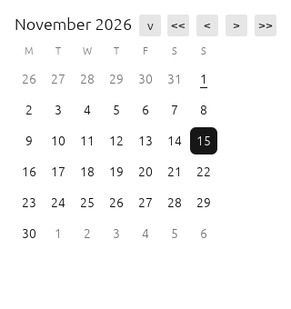
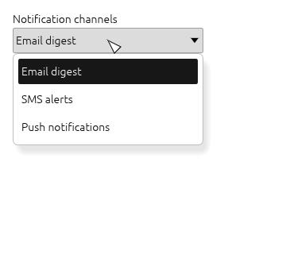

# Temivu

**一个实验性的 Forui 组件 Rust/egui 原生移植。**

[English](README.md) · [Tiếng Việt](README.vi.md) · [Русский](README.ru.md) · [中文](README.zh.md)

> **状态：早期实验，尚未达到生产可用。** Temivu 是我对“如何把 Forui 的设计语言迁移到
> Rust 与 egui 的即时模式”的独立研究。上游 44 个组件模块都已有初步移植，演示程序也
> 覆盖了全部组件，但没有任何组件经过完整的上游一致性验证，也还没有稳定版本。使用前请
> 阅读[已知限制](#已知限制)。


## 我为什么做这个项目

我喜欢 Forui 的视觉语言，但我用 Rust 编写原生桌面软件。我开始做 Temivu，是想验证能否
在不嵌入 Flutter 的情况下，得到同样的控件——按钮、表单、选择器、日历、浮层、导航——并
保持相同的间距、颜色 token、字体排印、键盘行为和可访问性。这是一个诚实的*研究*，而不是
Forui 引擎的复刻：项目把 Forui 公开的 token 和行为适配到 egui 的即时模式模型，所有跨帧
状态都由调用方持有。

我在开发过程中使用了一个 AI 编程助手（DeepSeek Harness）来完成大量机械性的草拟和验证
工作。项目范围、技术决策和验收标准由我制定，我对这里发布的内容负责。

## 项目内容

- **44 个初步组件模块**——accordion、alert、autocomplete、avatar、badge、
  bottom navigation、breadcrumb、button、calendar、card、checkbox、context menu、
  date field、date-time picker、dialog、divider、header、item、field label、line
  calendar、OTP field、pagination、picker、popover、popover menu、progress、radio、
  resizable、scaffold、select、select group、select menu tile、select tile group、
  sheet、sidebar、slider、switch、tabs、text field、tile、time field、time picker、
  toast、toaster 和 tooltip。
- **中性设计 token 主题**（浅色、深色、触屏尺寸、减少动效，以及可选的高对比度预设），
  包含字体排印和尺寸 token。
- **本地化基础设施**——从 113 个上游 ARB 文件生成 37 条语义消息，支持英语回退和
  语言区域子标签匹配。
- **五页原生演示**——`cargo run --features demo --example showcase`——覆盖所有组件
  家族、主题、减少动效和本地化。
- **测试**——402 个 Rust 测试，包括每个组件家族的真实输入 `egui_kittest` 交互测试、
  可访问性断言、确定性的日期/时间逻辑和主题对比度检查。



| 领域 | 目前情况 |
| --- | --- |
| 主题与 token | 可用于试验；颜色与尺寸改编自 Forui，包含高对比度预设 |
| 输入与按钮 | 已通过 kittest 验证键盘与屏幕阅读器；图标是文本字形近似 |
| 选择器、取件器、自动补全 | 初步支持搜索、多选、日历月/年选择、滚轮选择、时间/日期选择 |
| 浮层 | Dialog、sheet、popover、popover menu、toast/toaster 可用，但动画与手势尚不完整 |
| 视觉一致性 | 已明显接近上游但未证明；字体、图标、模糊和 Flutter 文本度量仍是差距 |
| 可访问性 | AccessKit 角色/标签/值和键盘路径已有测试；尚无人工屏幕阅读器审计 |

## 快速开始

需要 Rust 1.95 或更高版本（edition 2024）。库尚未发布到 crates.io；请通过路径或 git 使用。

```toml
[dependencies]
# from git:
temivu = { git = "https://github.com/vutienthan/temivu" }
# from a local clone instead:
# temivu = { path = "../temivu" }
egui = "=0.36.2"
```

> 如果你克隆了仓库，请使用上面注释中的 `path` 写法。

```rust
use temivu::{Button, Dialog, Header, Theme};

fn page(ui: &mut egui::Ui, dialog_open: &mut bool) {
    let theme = Theme::light();
    Header::new("示例", &theme).show(ui, |_| {});
    if Button::new("显示详情", &theme).show(ui).clicked() {
        *dialog_open = true;
    }
    Dialog::new(egui::Id::new("details-dialog"), "详情")
        .show(ui.ctx(), dialog_open, |ui| {
            ui.label("这里放详情内容。");
        });
}
```

主题变化时调用 `Theme::apply`。持久状态由调用方持有：请跨帧保存，并在每帧调用每个
控件（包括已关闭的浮层），以便 dialog 和 sheet 恢复焦点。ID 必须稳定且全局唯一。

在支持的图形桌面上运行演示：

```bash
cargo run --features demo --example showcase
```

运行测试（无需显示器）：

```bash
cargo test --all-features
```

## 项目结构

```
src/               库（44 个组件/基础模块）
tests/             单元测试与 egui_kittest 交互测试
examples/          五页原生演示
docs/              组件说明、覆盖矩阵、迁移与设计文档
harness/port/      生成 token 与本地化数据的提取器/校验器
harness/visual-review/  离屏截图工具、基准图和比较脚本
branding/          项目的临时品牌
third_party/       上游许可证文本
```

我开发时使用的完整内部质量工具链（CodeQL 快照、独立评审记录、依赖/许可证清单）有意
不放入公开仓库；可复用的生成器和视觉比较工具已经包含。

## 验证

我按层次验证改动：每次改动都运行格式化、将警告视为错误的 Clippy、完整测试和文档测试；
在集成里程碑运行 CodeQL、独立评审和依赖审计；视觉有变化的组件会重新渲染截图。当前状态：

- 402 个 Rust 测试和文档测试全部通过；
- CodeQL 扫描提取干净，仅有两条已复核的误报（布尔密码掩码标志）；
- 使用 Gitleaks 扫描历史记录，未发现凭据泄露；
- 已复核的浅色/深色组件图集位于 `harness/visual-review/baselines/`；
- 依赖警告记录在 [docs/DEPENDENCY_ADVISORIES.md](docs/DEPENDENCY_ADVISORIES.md)。

`cargo-deny` 目前报告三个*信息性“不再维护”*警告（`zvariant`、`zbus_names`、
`zvariant_derive`），位于可选的 Linux 可访问性依赖链中。它们没有被抑制：截至 2026 年
11 月没有兼容升级或受维护的替代方案，可访问性保持启用，问题公开跟踪。
`.github/workflows/` 中的 GitHub 工作流运行相同的质量、依赖和 CodeQL 检查；依赖任务
允许失败，以便报告而不是隐藏该问题。

## 已知限制

- **尚未达到生产可用。** API、视觉和行为仍会变化；还没有正式版本。
- **尚未证明上游一致性。** 字体、矢量图标、背景模糊、超椭圆圆角、Flutter 文本度量和
  动画曲线与 Forui 不同。仓库中的截图是与本项目早期版本比较，而不是上游基准图。
- **可访问性只有自动化覆盖。** AccessKit 角色、标签、值、键盘路径和对比度已有测试；
  尚未进行人工屏幕阅读器或强制颜色审计。
- **浮层不完整：** 进入/退出动画、滑动手势和部分焦点边界仍未实现。
- **本地化是部分的：** 已生成 37 条消息；日期、时间、数字、复数和 RTL 尚未实现。
- **尚未记录桌面会话或 CI 验证**；随附的工作流供贡献者和维护者使用。

## 参与贡献

我很希望 Temivu 成长为一个社区项目，也欢迎任何帮助。你不需要是 Rust 专家或深入了解
Forui——有好奇心就够了。可以帮忙的方向：

- **视觉一致性：** 将组件与固定的 Forui 版本
  （`eea1e8e651d263f14ef43897ccbb7a2576549da5`）比较并描述差异。
- **可访问性：** 键盘、屏幕阅读器、强制颜色和对比度审查。
- **本地化：** 日期/时间格式、复数、RTL 和更多语言。
- **性能：** 性能分析、帧时间测量和分配热点。
- **依赖：** 为可访问性警告链寻找受维护的替代方案——需要测试与许可证审查，而不是仅仅
  为了消除警告。

请从 [CONTRIBUTING.md](CONTRIBUTING.md) 和 issue 列表开始。如果不确定从哪里入手，可以
发起讨论或申请“good first issue”，我会礼貌地帮你找到符合兴趣的任务。也请阅读
[行为准则](CODE_OF_CONDUCT.md)。请保持友善；这是一个学习项目。



## 通往 1.0 的路线图

1. **Alpha**——所有范围内模块都有经过测试的 API，演示可构建并运行，行为差距记录在
   [docs/COVERAGE.md](docs/COVERAGE.md)。
2. **Beta**——达到可访问性基线，视觉矩阵使用可测量阈值比较，在有文档的参考机器上定义
   性能预算，文档改写为面向用户。
3. **1.0**——发布检查通过并记录已接受的限制：没有未解决的高危警告、通知完整、构建可
   复现、公共 API 稳定。详细范围将发布在 `docs/ROADMAP.md`，非常欢迎反馈。

## 许可证与署名

Temivu 使用 MIT 许可证，见 [LICENSE](LICENSE)。本项目独立开发，**与 Forui 或
Duobase IO 无关联，也未获其背书**。Forui 使用 MIT 许可证；其许可证文本以及其他被引用
包和字体的许可证文本收录在 [THIRD_PARTY_NOTICES.md](THIRD_PARTY_NOTICES.md) 和
`third_party/` 中。名称、logo 和标志是临时的，尚未进行商标检索；见
[BRANDING.md](BRANDING.md)。
